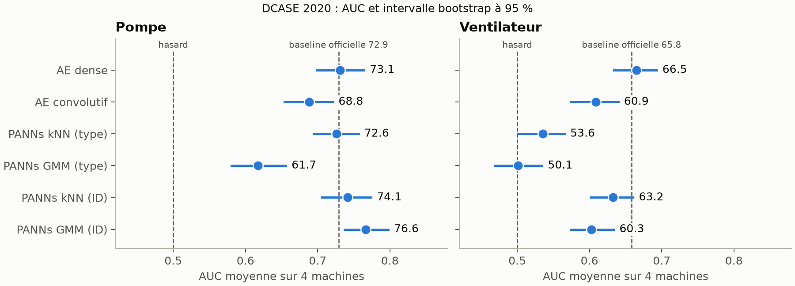
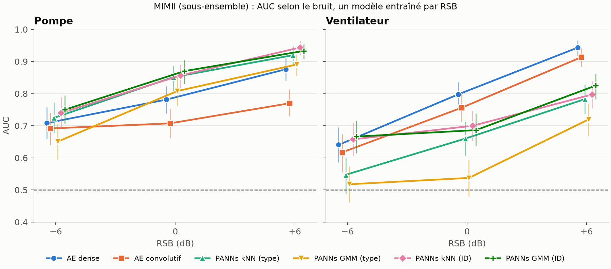
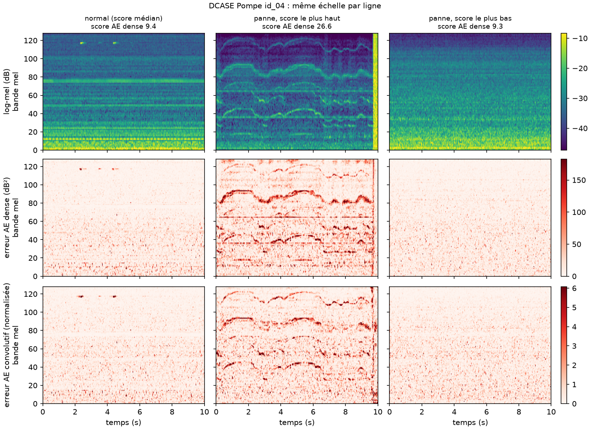
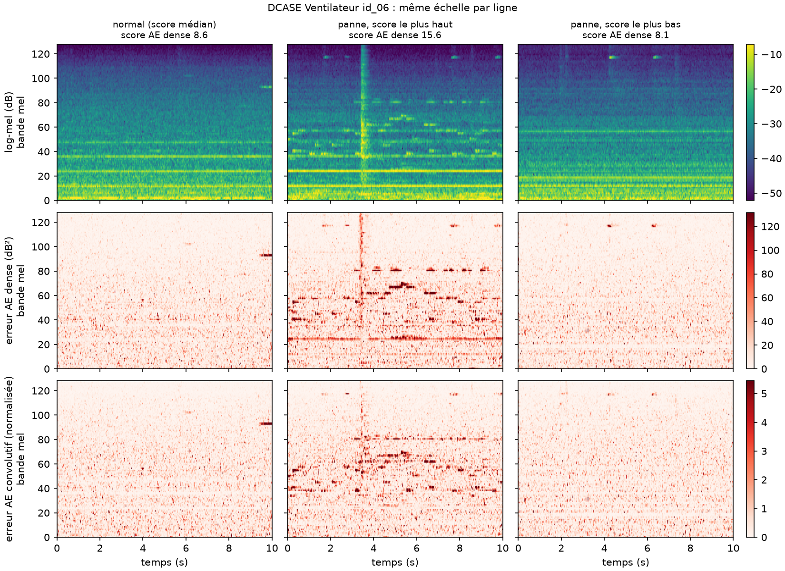

# Maintenance prédictive par l'audio : détection non supervisée de pannes

Mini-projet Deep Learning, IIA5, INSAT (encadrant : Ridha ALOUI).
Groupe : Mohamed Aziz Ben Rejeb, Wael Znagui, Maram Nuigues, Khalil Znazen, Aymen Turki.
Détection de sons anormaux de pompes et de ventilateurs en n'apprenant que sur des sons **normaux**.
Trois approches : autoencodeur dense, autoencodeur convolutif, embeddings PANNs (CNN14) + kNN / GMM.

Rapport : [`rapport/rapport.pdf`](rapport/rapport.pdf)

## Résultats

### DCASE 2020 Task 2 : AUC / pAUC (%)

Baseline officielle (moyenne de 10 entraînements) : pompe 72,89 / 59,99 ; ventilateur 65,83 / 52,45.

| Machine | ID | AE dense | AE conv. | kNN type | GMM type | kNN ID | GMM ID |
|---|---|---|---|---|---|---|---|
| Pompe | id_00 | 66,0 / 55,4 | 62,3 / 54,4 | 76,9 / 55,6 | 65,6 / 53,6 | 79,8 / 60,4 | 80,3 / 62,1 |
| Pompe | id_02 | 61,0 / 57,9 | 48,8 / 50,5 | 82,2 / 69,8 | 62,2 / 54,3 | 75,3 / 61,9 | 86,0 / 63,9 |
| Pompe | id_04 | 89,5 / 68,8 | 93,3 / 72,0 | 73,9 / 57,5 | 62,1 / 55,8 | 75,8 / 57,6 | 82,1 / 65,5 |
| Pompe | id_06 | 76,0 / 58,2 | 70,9 / 55,1 | 57,6 / 56,8 | 56,8 / 51,2 | 65,7 / 59,2 | 58,2 / 56,0 |
| Pompe | moyenne | 73,1 / 60,1 | 68,8 / 58,0 | 72,6 / 59,9 | 61,7 / 53,7 | 74,1 / 59,8 | 76,6 / 61,9 |
| Ventilateur | id_00 | 54,5 / 49,2 | 51,1 / 48,4 | 53,4 / 49,3 | 52,9 / 49,2 | 53,4 / 50,3 | 50,8 / 49,5 |
| Ventilateur | id_02 | 73,4 / 55,0 | 66,1 / 53,1 | 54,2 / 52,6 | 58,8 / 56,1 | 60,0 / 54,0 | 63,3 / 54,0 |
| Ventilateur | id_04 | 61,5 / 53,9 | 54,2 / 51,2 | 50,2 / 51,4 | 42,9 / 50,9 | 53,2 / 52,0 | 47,5 / 50,7 |
| Ventilateur | id_06 | 76,6 / 53,3 | 72,0 / 52,3 | 56,3 / 51,3 | 45,8 / 51,2 | 86,2 / 63,4 | 79,6 / 64,0 |
| Ventilateur | moyenne | 66,5 / 52,8 | 60,9 / 51,2 | 53,6 / 51,2 | 50,1 / 51,9 | 63,2 / 54,9 | 60,3 / 54,6 |



### Robustesse au bruit (sous-ensemble MIMII, moyenne de 4 machines) : AUC / pAUC (%)

| Machine | Modèle | -6 dB | 0 dB | +6 dB |
|---|---|---|---|---|
| Pompe | AE dense | 70,8 / 59,9 | 78,1 / 65,4 | 87,6 / 85,3 |
| Pompe | AE conv. | 69,1 / 61,7 | 70,7 / 65,3 | 77,0 / 80,9 |
| Pompe | kNN type | 72,5 / 59,2 | 85,1 / 68,7 | 92,0 / 74,4 |
| Pompe | GMM type | 65,0 / 56,7 | 80,8 / 64,3 | 89,1 / 72,3 |
| Pompe | kNN ID | 74,0 / 56,4 | 85,7 / 68,5 | 94,4 / 81,9 |
| Pompe | GMM ID | 75,0 / 56,7 | 87,0 / 75,7 | 93,3 / 79,5 |
| Ventilateur | AE dense | 64,0 / 52,3 | 79,8 / 62,6 | 94,3 / 81,6 |
| Ventilateur | AE conv. | 61,7 / 52,9 | 75,6 / 60,7 | 91,3 / 78,2 |
| Ventilateur | kNN type | 54,7 / 52,7 | 66,0 / 52,1 | 78,3 / 58,9 |
| Ventilateur | GMM type | 51,8 / 51,5 | 53,7 / 50,3 | 71,9 / 53,8 |
| Ventilateur | kNN ID | 65,8 / 53,9 | 70,0 / 58,6 | 79,7 / 65,9 |
| Ventilateur | GMM ID | 66,6 / 53,8 | 68,6 / 57,8 | 82,5 / 65,3 |



### Seuil au 90e percentile des normaux de validation (DCASE, %)

| Machine | Modèle | Perc. | Précision | Rappel | F1 | Fausses al. | Exact. équil. |
|---|---|---|---|---|---|---|---|
| Pompe | AE dense | 90 | 80,8 | 41,4 | 54,8 | 11,2 | 65,1 |
| Pompe | AE conv. | 90 | 78,1 | 47,8 | 59,3 | 15,2 | 66,3 |
| Pompe | kNN type | 90 | 82,1 | 37,3 | 51,3 | 9,2 | 64,0 |
| Pompe | GMM type | 90 | 66,8 | 31,4 | 42,7 | 17,8 | 56,8 |
| Pompe | kNN ID | 90 | 82,3 | 41,7 | 55,3 | 10,2 | 65,7 |
| Pompe | GMM ID | 90 | 81,3 | 41,0 | 54,5 | 10,8 | 65,1 |
| Pompe | alerte permanente | - | 53,3 | 100,0 | 69,5 | 100,0 | 50,0 |
| Ventilateur | AE dense | 90 | 88,2 | 27,8 | 42,3 | 13,8 | 57,0 |
| Ventilateur | AE conv. | 90 | 83,4 | 23,5 | 36,6 | 17,2 | 53,1 |
| Ventilateur | kNN type | 90 | 81,6 | 20,7 | 33,0 | 17,2 | 51,7 |
| Ventilateur | GMM type | 90 | 83,5 | 14,8 | 25,1 | 10,8 | 52,0 |
| Ventilateur | kNN ID | 90 | 88,1 | 32,5 | 47,4 | 16,2 | 58,1 |
| Ventilateur | GMM ID | 90 | 86,6 | 29,4 | 43,8 | 16,8 | 56,3 |
| Ventilateur | alerte permanente | - | 78,7 | 100,0 | 88,1 | 100,0 | 50,0 |

La précision et le F1 sont gonflés par la forte part d'anomalies du test : une alerte permanente a un meilleur F1 que
tous les modèles. La majorité des pannes est manquée.

### ONNX / INT8 (latence médiane par extrait de 10 s, i5-10300H, 1 thread, hors log-mel : 5,0 ms)

| Modèle | Version | Taille (Ko) | AUC pompe | AUC vent. | Latence (ms) |
|---|---|---|---|---|---|
| AE dense | FP32 | 1061 | 73,1 | 66,5 | 2,5 |
| AE dense | INT8 statique | 325 | 73,7 | 63,8 | 2,8 |
| AE dense | INT8 dynamique | 299 | 73,0 | 66,7 | 3,0 |
| AE conv. | FP32 | 1490 | 68,8 | 60,9 | 11,7 |
| AE conv. | INT8 statique | 430 | 70,1 | 59,2 | 8,0 |

Référence : CNN14 (PyTorch) 820 ms, 80 M de paramètres.

### Cartes d'erreur




## Limites

- Un seul entraînement par modèle ; les intervalles bootstrap ne couvrent que l'échantillon de test.
- Les variantes PANNs « ID » connaissent la machine, pas les autoencodeurs « type ».
- MIMII : 250 extraits par machine et par RSB, 100 en test ; les petits écarts ne sont pas concluants.
- Un score élevé signale un son inhabituel (parfois du bruit d'usine), pas nécessairement une panne.
- Latence mesurée sur un ordinateur portable, pas sur une carte embarquée.

## Utilisation

Démo (les modèles et les exemples sont dans `demo/`) :

```
pip install -r requirements.txt
python app.py
```

Reproduire les résultats (`MIMII_ROOT` : dossier de données, par défaut `D:/mimii`) :

```
pip install -r requirements-dev.txt
python -m pytest tests
python scripts/download_mimii_subset.py
python scripts/run_all.py
python scripts/noise_table.py
python scripts/evaluate.py
python scripts/error_maps.py
python scripts/export_onnx.py
python scripts/prepare_demo.py
python scripts/make_tables.py
python scripts/error_maps.py --en
python scripts/make_slides.py
```

`error_maps.py` et `export_onnx.py` tournent sur CPU : définir `CUDA_VISIBLE_DEVICES=-1`.
Placer avant cela les données DCASE (`dev_data_pump.zip`, `dev_data_fan.zip`, extraites dans `$MIMII_ROOT/dcase`)
et les poids `Cnn14_16k_mAP=0.438.pth` (renommés `$MIMII_ROOT/panns/Cnn14_16k.pth`).
Le notebook [`kaggle/train_kaggle.ipynb`](kaggle/train_kaggle.ipynb) télécharge les données et lance tous les
entraînements (Tesla T4).

| Dossier | Contenu |
|---|---|
| `src/asd` | données, log-mel, modèles, scores, métriques |
| `scripts` | entraînement, évaluation, export, préparation de la démo |
| `results` | scores par extrait, tableaux, figures |
| `demo`, `app.py` | application Gradio |
| `rapport` | rapport LaTeX et PDF |
| `presentation` | diapositives (anglais), modèle Capsule, licence MIT |

## Sources et licences

- DCASE 2020 Task 2 Development Dataset, [Zenodo 3678171](https://zenodo.org/records/3678171), CC BY-NC-SA 4.0 (les clips de `demo/examples` en proviennent)
- Purohit et al., *MIMII Dataset*, DCASE Workshop 2019, [Zenodo 3384388](https://zenodo.org/records/3384388), CC BY-SA 4.0
- Koizumi et al., *Description and Discussion on DCASE2020 Challenge Task2*, DCASE Workshop 2020
- Kong et al., *PANNs*, IEEE/ACM TASLP 2020, poids : [Zenodo 3987831](https://zenodo.org/records/3987831)
